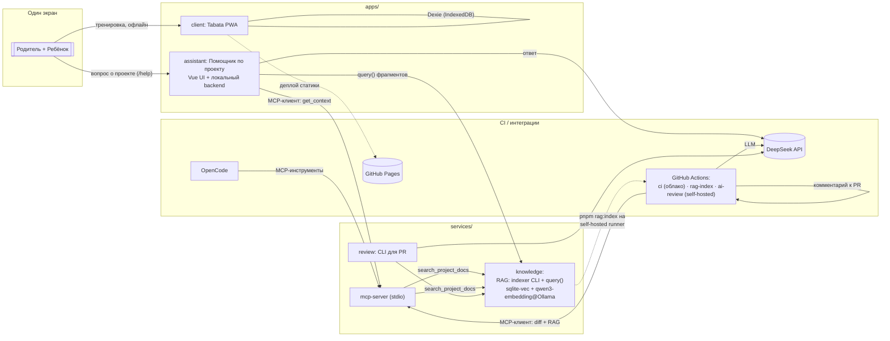

# Архитектура

Обзор системы. Детальные решения — в [ADR](adr/), терминология — в [глоссарии](../GLOSSARY.md), спецификации — в [specs](../specs/).

## Система: две подсистемы

Проект — см. [GLOSSARY](../GLOSSARY.md) — связывает:

1. **Продукт** — PWA для совместных тренировок: Tabata-таймер, шаблоны, история. Работает полностью локально (ADR-0003).
2. **AI-инфраструктура проекта** — Помощник (`/help`), MCP-сервер, RAG, автоматический review. Владелец — сам проект: помогает разрабатывать продукт и ориентироваться в нём (ADR-0004).



## Bounded contexts

| Контекст | Назначение | Статус | Спека |
|---|---|---|---|
| `Training` | Протоколы, шаблоны, сессии, таймер-движок, локальная история | MVP | [001](../specs/001-tabata-timer/) |
| `Git Context (MCP)` | Инструменты git-контекста для AI-потребителей | MVP | [002](../specs/002-mcp-server/) |
| `Project Knowledge` | Фрагменты знаний, индексация, поиск по проекту | MVP | [003](../specs/003-knowledge-rag/) |
| `Assistant Q&A` | «Помощник по проекту»: вопрос → контекст → ответ с цитатами | MVP | [004](../specs/004-project-assistant/) |
| `Automated Review` | CLI ревью + workflows (ci, rag-index, ai-review) | MVP | [005](../specs/005-ci-ai-review/) |
| `Family & Accounts` | Аккаунты, роли родитель/ребёнок, синхронизация | будущее | — |
| `Remote Multiplayer` | Совместная тренировка на разных устройствах | будущее | — |

## Потоки

1. **Тренировка** — пользователь открывает PWA, выбирает шаблон/пресет, запускает сессию; таймер-движок ведёт фазы (подготовка → работа → отдых × раунды × циклы) по меткам времени, звуковые сигналы через Web Audio; по завершении сессия пишется в IndexedDB. Сеть не нужна.
2. **Вопрос Помощнику** — UI → `POST /api/ask` → MCP-клиент (`get_context`: ветка, статус, изменённые файлы) + `knowledge.query()` (top-k фрагментов) → DeepSeek генерирует ответ **только** на основе переданного контекста → ответ с цитатами (файл, заголовок).
3. **Индексация** — `pnpm rag:index` (вручную или самодостаточный self-hosted workflow `rag-index.yml` после push в main): обходим репо, чанкуем (markdown по заголовкам, код по файлам), эмбеддинги Ollama, пишем в sqlite-vec **инкрементально** по хешу файла.
4. **AI Code Review** — `pull_request` → self-hosted `ai-review.yml` → CLI `pnpm review:run` — MCP-клиент (`git_diff { base, head }`, `changed_files`, `search_project_docs` — top фрагментов к изменённым областям) → DeepSeek → находки по Critical/High/Medium/Low → один обновляемый комментарий бота. Non-blocking (ADR-0007).

## Модель данных

Продукт (IndexedDB/Dexie):

```
TabataProtocol  { prepareSec, workSec, restSec, rounds, cycles, restBetweenCyclesSec }
WorkoutTemplate { id, name, protocol, isPreset }          // пресет | пользовательский
TrainingSession { id, startedAt, finishedAt?, templateId,
                  protocolSnapshot, completedRounds,
                  status: in_progress | completed | abandoned }
```

Project Knowledge (sqlite-vec, `.data/knowledge.db`, вне git):

```
IndexedChunk { id, filePath, fileType (readme|docs|specs|adr|code|config),
               headingPath, content, embedding, fileHash }
```

Review — результат в виде PR-комментария (markdown), находка: `{ severity, file, line?, message, recommendation }`.

## Инфраструктура и деплой

| Компонент | Где работает | Зависимости |
|---|---|---|
| client PWA | GitHub Pages (HTTPS, installable) | без сети |
| assistant | локально, `pnpm assistant:dev` | Node, Ollama, ключ DeepSeek в `.env` |
| knowledge | библиотека + CLI, индекс в `.data/` | Ollama (qwen3-embedding) |
| mcp-server | stdio-процесс, спавнится потребителями | Node; для поиска — Ollama |
| ci.yml | cloud (облако GitHub) | Node 22 LTS, pnpm |
| rag-index.yml / ai-review.yml | [self-hosted runner](../specs/005-ci-ai-review/) | Ollama, GitHub secret `DEEPSEEK_API_KEY` |

## MVP и за его пределами

**MVP** — все пять спек выше. **Не в MVP:** аккаунты/backend/синхронизация, мультиплеер, библиотека упражнений, аналитика, TTS, мультитаймеры, Capacitor/сторы, i18n, публикация Помощника. Быстрый срок воркфлоу — см. `005-ci-ai-review/spec.md`.
